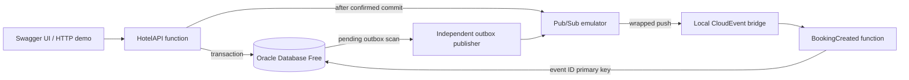

# Local architecture and interview walkthrough

The Functions Framework registers both targets in `functions.go`. The same
non-root runtime image runs either target; Compose deploys them as separate
containers. `internal/booking` defines date/capacity/input rules,
`internal/httpapi` maps HTTP and errors, `internal/store` owns Oracle queries and
transactions, and `internal/events` owns the event contract and delivery.

The original challenge's reviewer cycle is preserved: reset, seed, partial
hotel search, availability, booking, reference lookup, availability verification,
and reset. This is a personal Go adaptation of a C#/EF Core exercise.

The key interview points:

1. **Availability is a snapshot.** Two requests can observe the same room.
   Oracle's `(RoomId, StayDate)` primary key gives each night one owner. Each
   transaction writes booking, nights, and outbox together. Candidate rollback
   removes every partial write before the next room is tried.
2. **Checkout is exclusive.** A January 1–3 stay occupies January 1 and 2.
   Another guest can check in January 3. Dates are normalized to UTC midnight;
   today is validated against an injectable clock.
3. **Publish follows commit.** An event never announces a rolled-back booking.
   Oracle and Pub/Sub cannot commit atomically. The outbox closes the failure
   window by durably recording delivery intent in the booking transaction.
4. **Success and delivery differ.** A committed booking returns `201` while an
   unavailable publisher leaves `event_delivery=pending`. The independent
   publisher makes progress every five seconds without another API request.
5. **Duplicates are expected.** Publish can succeed before the database mark
   fails. Retrying preserves `event_id`; the consumer's primary key records one
   processing result. Concurrent duplicate delivery is also safe. The consumer
   locks its outbox row before writing an audit; reset deletes outbox rows before
   audits, so delayed deliveries cannot restore data that the demo discarded.
6. **The worker is an extension.** API-only Compose uses no Pub/Sub dependency.
   The event profile adds the emulator, adapter, actual function, and retry
   process. The adapter returns worker failures so push delivery can retry.

The pool uses at most 10 open/5 idle connections with a five-minute lifetime.
HTTP and worker calls use 30-second deadlines; immediate publication gets at
most three seconds. Public references contain 128 random bits. Event payloads
exclude guest names. Admin/schema operations require explicit local/demo mode.

Oracle data persists in a named volume. Emulator topics/subscriptions are
in-memory and must be recreated after an emulator restart. Run destructive demo
seed/reset scripts sequentially, with fictional data. The schema runner checks
existing definitions; Oracle DDL is independently committed and reruns resume
missing objects rather than promising rollback.

Phase 5 is deferred: this repository has not provisioned hosted Oracle, private
GCP networking, managed secrets, IAM, Eventarc triggers, or billable services.
