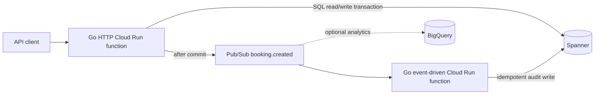

# Go Hotel Booking Backend — GCP Project Plan

## Goal

Rebuild the [hotel booking demo](https://github.com/sses79/hotel-booking) as a small Go project on Google Cloud. Complete the original challenge's API test cycle—reset, seed, search, availability, booking, lookup, and verification—before adding Pub/Sub and a separate event-handling GCF extension. Demonstrate Go services, SQL, Google Spanner, Pub/Sub, cloud deployment, and production-minded delivery.

The [original challenge](https://github.com/sses79/hotel-booking/blob/dev/challenge.md), [.NET solution summary](https://github.com/sses79/hotel-booking/blob/dev/docs/hotel-booking-challenge-solution.md), and [.NET implementation](https://github.com/sses79/hotel-booking) are the primary behavior reference. The [Python project](https://github.com/sses79/hotel-booking-python) is a secondary reference for container workflow and a stronger booking-reference format. This Go project explores a different stack; it is not a submission that meets the original challenge's C#/EF Core requirement.

## Local-First Approach And Lessons From The Existing Demos

Start with a fully containerized local workflow before any GCP deployment. Both existing demos use Compose to run an API and SQL database; the Python demo also separates schema migration from API startup. Preserve the .NET demo's full reviewer workflow, partial hotel-name search, stable room ordering, and six-room Grand Plaza dataset. Translate its transaction behavior to Spanner instead of copying SQL Server or PostgreSQL locking, migrations, or cloud infrastructure.

The local Go stack uses the **Spanner emulator**. Run the API through the same Go Functions Framework entry point intended for deployment. Use a one-shot Go schema command to create the emulator instance/database and apply versioned GoogleSQL DDL. Provide `POST /api/v1/admin/seed` and `POST /api/v1/admin/reset` for the demo cycle; schema changes remain a separate command. The emulator is in memory, so restarting it loses the schema and seed data; the documented startup sequence must recreate both.

The first local milestone should be usable without installing Go or `gcloud` on the host: Docker and Docker Compose are the only required tools. Bind the source tree into a Go development container, keep the module cache in a named volume, and use `go run` for the local function server. A separate multi-stage Dockerfile should produce a small non-root image for deployment. Pin toolchain and dependency versions rather than relying on moving `latest` tags.

## Scope

### Core API demo

- Search hotels by an optional partial name and return a list, matching the .NET demo.
- List rooms available for a whole stay, filtered by dates, guest count, and optional room type.
- Create a booking for one suitable room and return a public booking reference.
- Retrieve a booking by reference.
- Expose API seed and reset operations for a complete, repeatable local/demo cycle.
- Serve OpenAPI and Swagger UI so the full cycle can be tested without writing a client.

### Pub/Sub and GCF extension

- Publish a `booking.created` event to Pub/Sub after a successful Spanner commit.
- Process the event in a separate Go CloudEvent function and record an idempotent delivery/audit result.

No frontend, payments, customer accounts, or real notifications are needed. Use fictional guest data in demos.

## Architecture



The **local events profile** runs the HTTP API, the Pub/Sub-triggered Go function, and both emulators in containers. Both functions use the same source image with different Functions Framework targets. A small local-only bridge translates Pub/Sub emulator push requests into Eventarc-style CloudEvents HTTP requests for the function; the cloud deployment uses Eventarc directly.

- Deploy the API and event consumer independently as **Cloud Run functions**, using the Go Functions Framework.
- Use one Spanner database as the operational SQL store. Choose the **GoogleSQL dialect** for a direct introduction to Spanner; document differences from PostgreSQL encountered during implementation.
- Use Pub/Sub for asynchronous delivery. The consumer must tolerate duplicate delivery.
- Keep BigQuery optional and use it only for aggregate reporting, not booking creation or point lookups.
- Reuse one Spanner client and one Pub/Sub publisher per warm function instance; pass request contexts and deadlines to calls.
- Keep the API demo usable when Pub/Sub is absent. The GCF event handler extends the completed API rather than being required for reset, seed, search, availability, booking, or lookup.

## Data Model

```text
Hotels(HotelId PK, Name, CreatedAt)
Rooms(RoomId PK, HotelId, RoomNumber, RoomType, Capacity)
Bookings(BookingId PK, Reference UNIQUE, HotelId, RoomId,
         GuestName, GuestCount, CheckInDate, CheckOutDate, CreatedAt)
OccupiedNights(RoomId, StayDate, BookingId, PK(RoomId, StayDate))
ProcessedEvents(EventId PK, BookingId, ProcessedAt)
```

Use application-generated UUIDs, UTC timestamps, and half-open stays `[check_in, check_out)`. Validate `check_in < check_out`, guest count, capacity, and a bounded stay length (for example, at most 30 nights). A night is occupied for each date from check-in through the day before check-out. Back-to-back stays are valid.

Preserve the .NET demo's rule that check-in is today or later. Make the current UTC date injectable for deterministic tests. Reuse its fixed hotel/room IDs. Generate references such as `HB-` followed by 32 uppercase hexadecimal characters: recognizable like the .NET demo, with the stronger random format from the Python demo.

`OccupiedNights` replaces the source projects' database-specific overlap techniques. A room/date primary key can belong to only one booking. Spanner transactions atomically insert the booking and its occupied-night rows. Do not copy SQL Server serializable range-lock code, PostgreSQL `SKIP LOCKED`, or PostgreSQL exclusion constraints.

## Booking Transaction And Event Flow

1. Validate request and select suitable rooms in stable order: capacity, room type, room number.
2. For each candidate, run a short Spanner read-write transaction that checks the requested nights and inserts the booking plus all `OccupiedNights` rows. Let Spanner's Go client retry aborted transactions. If a room/date key is already taken, try the next candidate or return `409 Conflict`.
3. Keep the transaction callback free of external side effects. In particular, **never publish to Pub/Sub inside it** because Spanner can rerun the callback.
4. After a confirmed commit, publish a `booking.created` message containing a stable `event_id`, booking reference, hotel ID, room ID, and creation time. Avoid guest name and other personal data in the event.
5. The worker records `event_id` in `ProcessedEvents` using a transaction. If it already exists, acknowledge the duplicate without repeating work.

The Spanner commit and Pub/Sub publish are **not one atomic transaction**. Create `OutboxEvents` with the booking schema and write an outbox row in the booking transaction from the start. When Pub/Sub is added, attempt immediate publication after commit and use an independently invoked publisher to retry pending rows. Use the same `event_id` for every attempt and make the consumer idempotent. Return booking success after a confirmed commit even when immediate publication fails; report delivery as pending separately.

## API Contract

```text
GET  /api/v1/hotels?name=...                 # optional partial name; list response
GET  /api/v1/hotels/{hotel_id}/rooms/available?check_in=...&check_out=...&guests=...&room_type=...
POST /api/v1/bookings
GET  /api/v1/bookings/{reference}
POST /api/v1/admin/seed
POST /api/v1/admin/reset
GET  /health/live
GET  /health/ready
GET  /openapi.yaml
GET  /docs
```

`POST /bookings` returns `201 Created`, a booking body, and `Location: /api/v1/bookings/{reference}` after the database commit. Include hotel name, room number/type/capacity, guest count, stay dates, and creation time in booking details, as the .NET demo does. Document the event delivery state separately from booking success. Seed first resets all demo data and then creates the fixed hotel and six rooms without bookings; reset removes bookings, occupied nights, outbox/processed-event rows, rooms, and hotels, returning `204`. Neither operation changes the schema. Return `400` for invalid input, `404` for unknown resources, `409` for unavailable rooms, and `503` for a database outage. Use a stable JSON error shape with `code`, `message`, and request ID. Serve the repository OpenAPI specification and a Swagger UI locally for manual testing.

The local demo has no application authentication, as in the challenge. Register admin routes only in explicit `local` or `demo` mode. A GCP demo deployment can enable those routes to run the full cycle through the API, with authenticated Cloud Run invocation controlling access to the whole service. Do not enable reset/seed routes in a production configuration.

## Code Structure

```text
hotel-booking-go/
  cmd/schema/               # one-shot emulator instance/database and DDL setup
  cmd/local/                # local Functions Framework launcher
  cmd/eventbridge/          # local-only Pub/Sub push to CloudEvent adapter
  functions.go              # registers both deployable function entry points
  internal/httpapi/         # HTTP routes and response mapping
  internal/eventhandler/    # Pub/Sub CloudEvent handler
  internal/booking/         # booking rules and use cases
  internal/hotel/           # search and availability
  internal/testdata/        # API seed/reset use cases
  internal/store/           # Spanner queries and transactions
  internal/events/          # event contract and Pub/Sub publisher
  schema/                   # versioned Spanner DDL
  api/openapi.yaml
  tests/
  infra/                   # deployment scripts or Terraform
  README.md
  go.mod
```

Deploy the two registered entry points separately from the same module root, as required by the Go Functions Framework source layout. Keep HTTP and CloudEvent handlers thin. Put domain decisions in services, Spanner access in the store, and event serialization/publishing behind a small interface. Avoid a generic repository framework for this demo.

## Local Development And Verification

- `infra/local/compose.yaml` starts a Spanner emulator and the Go HTTP function. Publish the API on a configurable host port; bind emulator ports to localhost only if host-side debugging needs them. Supply `SPANNER_EMULATOR_HOST` and a fictional project/instance/database ID to the application containers, never cloud credentials.
- Provide a one-shot Compose service or `docker compose run --rm` command for schema setup and Go tests. Schema setup waits for emulator readiness and applies versioned DDL. Seed and reset run through the API, so the documented demo commands exercise the same path as a reviewer. Do not reset data as part of ordinary API startup.
- The first vertical slice is `docker compose up --build`, schema setup, `POST /api/v1/admin/seed`, `GET /health/ready`, and partial-name hotel search. Complete availability, booking, lookup, and reset through HTTP before introducing Pub/Sub.
- Document one end-to-end script using future dates: reset, seed, search for `Grand`, list suitable rooms, book room 201, look up its reference, confirm room 201 is no longer available for those nights, then reset and confirm search returns an empty list.
- Add an `events` Compose profile containing the Pub/Sub emulator, a one-shot topic/push-subscription setup command, the Go function container with `FUNCTION_TARGET=BookingCreated`, and a small event bridge. Configure the emulator with `PUBSUB_EMULATOR_HOST=pubsub:8085` and create a push subscription pointing at the bridge on the Compose network. The bridge keeps the wrapped Pub/Sub message body, adds the CloudEvents headers Eventarc would provide, forwards to the function, and passes success/failure status back so failed handling can be retried. Test that translation with a representative Pub/Sub push fixture. Do not describe the emulator as an Eventarc emulator.
- Use the Spanner emulator for database integration tests. Its read-write transactions lock the whole database, so do not treat local contention behavior or timings as a production concurrency test; run a small final concurrency smoke test against the free-trial instance.
- Test date boundaries, capacity, stable room selection, back-to-back stays, unknown resources, and event serialization with focused unit tests.
- Run an integration test where two concurrent requests try to book the last room for the same nights: exactly one succeeds; the other receives a conflict. Verify no partial `OccupiedNights` rows remain.
- Test a failed Pub/Sub publish after a committed booking, then successful outbox replay without duplicate worker effects.
- Run `go test ./...`, `go test -race ./...`, `go vet ./...`, and formatting checks. Keep the deployed smoke test small and repeatable.

## GCP Deployment And Cost Boundary

- Use a dedicated project and one region for the functions, Spanner, and Pub/Sub. Grant each function only the Spanner and Pub/Sub permissions it needs. Use authenticated invocation for a deployed demo API, including its seed/reset routes, and disable those routes outside explicit local/demo mode.
- Spanner offers a **90-day free trial instance** with up to **10 GB**, not an indefinite free database. Cloud Run functions and Pub/Sub have usage-based free allowances, but other charges can still occur. Set a billing budget and review the current pricing before deployment.
- Do not add a continuously running Dataflow pipeline for this low-traffic demo. It would add recurring compute cost. A Spanner change stream to Pub/Sub is a separate, optional exploration.
- Keep schema creation, seed, deploy, smoke test, and teardown documented as separate commands. Never commit credentials, `.env` files, or Terraform state.

## Delivery Phases

1. **Containerized local foundation:** Go module, Functions Framework HTTP entry point, configuration, structured logging, health routes, Dockerfile, Compose with Spanner emulator, versioned schema including the outbox table, schema setup command, API seed/reset endpoints, partial hotel search, and local run instructions. Exit when a clean Docker-only checkout can start the API, reach readiness, seed the six rooms, search for `Grand`, reset, and search an empty database.
2. **Complete API demo:** Availability endpoint, transactional booking and lookup, served OpenAPI and Swagger UI, end-to-end HTTP demo script, and focused integration tests. Exit when the full reset-to-booking-to-reset cycle works through the Compose API and room-night uniqueness holds.
3. **Pub/Sub and GCF extension:** Pub/Sub emulator, post-commit publisher, local push-to-CloudEvent bridge, separately containerized CloudEvent function entry point for GCF, stable event ID, idempotent processing, and failure tests. Exit when an API booking publishes through the emulator and invokes the actual function container, producing one auditable result even after duplicate delivery.
4. **Reliability:** Outbox retry publisher, explicit retry scheduling, and recovery demonstration after a failed publish. Exit when a pending event is eventually delivered without duplicate worker effects.
5. **GCP demo:** Deploy to a Spanner free-trial instance, configure Eventarc retries and IAM, run smoke and final concurrency tests, document costs and teardown, and capture an architecture diagram plus short interview walkthrough.

## Interview Walkthrough

Be ready to explain how the complete API demo maps to the original .NET challenge; why booking correctness moved from SQL Server's serializable range locking to Spanner transaction logic and unique room-night keys; why Pub/Sub publishing follows the commit; how duplicate events are handled; what happens when publishing fails; and why the event handler is a separate GCF extension. State clearly that this is a personal Go adaptation and distinguish it from production Go work on your CV.

## Reference Documentation

- [Spanner transactions and automatic retries](https://docs.cloud.google.com/spanner/docs/transactions)
- [Spanner emulator](https://docs.cloud.google.com/spanner/docs/emulator)
- [Cloud Run functions in Go](https://docs.cloud.google.com/run/docs/write-functions)
- [Pub/Sub-triggered functions](https://docs.cloud.google.com/run/docs/function-triggers)
- [Spanner free trial instance](https://docs.cloud.google.com/spanner/docs/free-trial-instance)
- [Spanner change streams to Pub/Sub through Dataflow](https://docs.cloud.google.com/dataflow/docs/guides/templates/provided/cloud-spanner-change-streams-to-pubsub)
